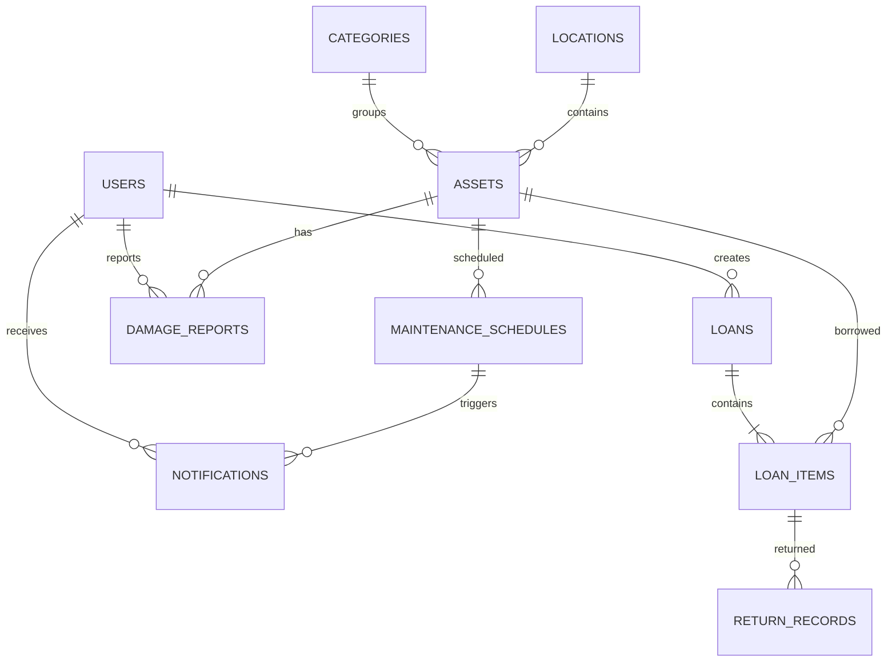

# Database Schema — LIMMS

**Produk:** Laboratory Inventory and Maintenance Management System (LIMMS)  
**Versi dokumen:** 1.0  
**Tanggal:** 26 November 2026  
**Acuan:** PRD LIMMS versi 1.0 dan rancangan ERD awal  
**Status:** Draft skema logis; DBMS/ORM belum ditetapkan.

---

## 1. Tujuan

Dokumen ini menjelaskan rancangan struktur basis data untuk mendukung kebutuhan LIMMS: pengelolaan aset, kategori, lokasi, kondisi, peminjaman, pengembalian, jadwal pemeliharaan, laporan kerusakan, notifikasi, dashboard, dan laporan aset.

PRD belum menetapkan DBMS, ORM, atau tipe data teknis. Untuk contoh definisi SQL pada dokumen ini digunakan sintaks **PostgreSQL sebagai rekomendasi**. Jika kelompok memilih DBMS lain, tipe data dan sintaks perlu disesuaikan.

## 2. Prinsip Perancangan

1. Setiap entitas utama memiliki primary key.
2. Relasi antar data dijaga menggunakan foreign key.
3. Kode aset bersifat unik.
4. Data transaksi tidak boleh membuat status aset menjadi tidak konsisten.
5. Timestamp pencatatan disimpan untuk mendukung audit dasar.
6. Data referensi kategori dan lokasi dipisahkan dari tabel aset.
7. Data laporan/dashboard dihasilkan dari data operasional, bukan disimpan sebagai angka duplikat tanpa kebutuhan.

## 3. Ruang Lingkup Entitas

| Tabel | Fungsi | Keterkaitan PRD |
|---|---|---|
| `users` | Pengguna sistem | Peran pengguna usulan |
| `categories` | Kategori aset | FR-02 |
| `locations` | Lokasi aset | FR-03 |
| `assets` | Data inventaris aset | FR-01, FR-03, FR-09, FR-10 |
| `loans` | Header transaksi peminjaman | FR-04 |
| `loan_items` | Daftar aset dalam peminjaman | FR-04, FR-05 |
| `return_records` | Pencatatan pengembalian | FR-05 |
| `maintenance_schedules` | Jadwal pemeliharaan | FR-06, FR-08, FR-10 |
| `damage_reports` | Laporan kerusakan | FR-07, FR-10 |
| `notifications` | Notifikasi jadwal pemeliharaan | FR-08 |

`users` dan atribut role merupakan rancangan pendukung. Peran dan hak akses final perlu dikonfirmasi karena PRD hanya menyebutnya sebagai usulan.

## 4. Relasi Antar Tabel



Relasi di atas merupakan model awal. Relasi pengembalian satu-ke-banyak terhadap `loan_items` memungkinkan pencatatan pengembalian per item. Kebijakan pengembalian sebagian tetap harus disetujui.

## 5. Definisi Tabel

Tipe data di bawah menggunakan PostgreSQL. `UUID` direkomendasikan untuk primary key; `BIGINT GENERATED ... AS IDENTITY` juga dapat dipakai jika tim lebih nyaman dengan ID numerik. Pilih satu pola secara konsisten.

### 5.1 `users`

Menyimpan akun pengguna.

| Kolom | Tipe | Constraint | Keterangan |
|---|---|---|---|
| `id` | UUID | PK | ID pengguna |
| `name` | VARCHAR(120) | NOT NULL | Nama pengguna |
| `email` | VARCHAR(255) | UNIQUE, NOT NULL | Email akun |
| `password_hash` | TEXT | NOT NULL | Hash kata sandi, bukan plaintext |
| `role` | VARCHAR(30) | NOT NULL | Peran pengguna usulan |
| `is_active` | BOOLEAN | NOT NULL DEFAULT TRUE | Status akun |
| `created_at` | TIMESTAMPTZ | NOT NULL DEFAULT NOW() | Waktu dibuat |
| `updated_at` | TIMESTAMPTZ | NOT NULL DEFAULT NOW() | Waktu diperbarui |

Usulan nilai `role`: `administrator`, `laboran`, `peminjam`. Nilai ini perlu dikonfirmasi dan dapat diganti sesuai pembagian aktor final.

### 5.2 `categories`

Menyimpan kategori barang dan peralatan.

| Kolom | Tipe | Constraint | Keterangan |
|---|---|---|---|
| `id` | UUID | PK | ID kategori |
| `name` | VARCHAR(100) | UNIQUE, NOT NULL | Nama kategori |
| `description` | TEXT | NULL | Deskripsi kategori |
| `created_at` | TIMESTAMPTZ | NOT NULL DEFAULT NOW() | Waktu dibuat |
| `updated_at` | TIMESTAMPTZ | NOT NULL DEFAULT NOW() | Waktu diperbarui |

### 5.3 `locations`

Menyimpan lokasi aset di lingkungan laboratorium.

| Kolom | Tipe | Constraint | Keterangan |
|---|---|---|---|
| `id` | UUID | PK | ID lokasi |
| `name` | VARCHAR(120) | NOT NULL | Nama lokasi/ruangan |
| `description` | TEXT | NULL | Keterangan lokasi |
| `created_at` | TIMESTAMPTZ | NOT NULL DEFAULT NOW() | Waktu dibuat |
| `updated_at` | TIMESTAMPTZ | NOT NULL DEFAULT NOW() | Waktu diperbarui |

Jika dibutuhkan, tim dapat menambahkan kode ruangan atau hierarki gedung/lantai setelah kebutuhan lokasi dikonfirmasi.

### 5.4 `assets`

Menyimpan inventaris aset laboratorium.

| Kolom | Tipe | Constraint | Keterangan |
|---|---|---|---|
| `id` | UUID | PK | ID aset |
| `asset_code` | VARCHAR(60) | UNIQUE, NOT NULL | Kode unik aset |
| `name` | VARCHAR(160) | NOT NULL | Nama aset |
| `description` | TEXT | NULL | Deskripsi aset |
| `category_id` | UUID | FK → `categories.id`, NOT NULL | Kategori aset |
| `location_id` | UUID | FK → `locations.id`, NULL | Lokasi aset |
| `condition` | VARCHAR(30) | NOT NULL | Kondisi aset |
| `status` | VARCHAR(30) | NOT NULL | Status operasional aset |
| `acquisition_date` | DATE | NULL | Tanggal perolehan, jika diketahui |
| `notes` | TEXT | NULL | Catatan |
| `created_at` | TIMESTAMPTZ | NOT NULL DEFAULT NOW() | Waktu dibuat |
| `updated_at` | TIMESTAMPTZ | NOT NULL DEFAULT NOW() | Waktu diperbarui |

Usulan nilai `condition`: `good`, `needs_attention`, `damaged`.  
Usulan nilai `status`: `available`, `borrowed`, `maintenance`, `inactive`.

Kondisi fisik dan status operasional dipisahkan karena keduanya mewakili hal berbeda. Contohnya, aset dapat berkondisi `good` tetapi berstatus `borrowed`.

### 5.5 `loans`

Menyimpan informasi utama transaksi peminjaman.

| Kolom | Tipe | Constraint | Keterangan |
|---|---|---|---|
| `id` | UUID | PK | ID transaksi |
| `loan_code` | VARCHAR(60) | UNIQUE, NOT NULL | Kode peminjaman |
| `borrower_id` | UUID | FK → `users.id`, NOT NULL | Pengguna peminjam |
| `created_by` | UUID | FK → `users.id`, NULL | Petugas pencatat, jika berbeda |
| `loan_date` | DATE | NOT NULL | Tanggal peminjaman |
| `expected_return_date` | DATE | NOT NULL | Rencana tanggal kembali |
| `status` | VARCHAR(30) | NOT NULL | Status transaksi |
| `purpose` | TEXT | NULL | Keperluan peminjaman |
| `notes` | TEXT | NULL | Catatan |
| `created_at` | TIMESTAMPTZ | NOT NULL DEFAULT NOW() | Waktu dibuat |
| `updated_at` | TIMESTAMPTZ | NOT NULL DEFAULT NOW() | Waktu diperbarui |

Usulan nilai `status`: `pending`, `approved`, `rejected`, `borrowed`, `completed`, `overdue`, `cancelled`. Status dan alur persetujuan belum ditetapkan PRD.

### 5.6 `loan_items`

Menyimpan setiap aset yang termasuk dalam transaksi peminjaman.

| Kolom | Tipe | Constraint | Keterangan |
|---|---|---|---|
| `id` | UUID | PK | ID item |
| `loan_id` | UUID | FK → `loans.id`, NOT NULL | Transaksi induk |
| `asset_id` | UUID | FK → `assets.id`, NOT NULL | Aset yang dipinjam |
| `item_status` | VARCHAR(30) | NOT NULL | Status item |
| `condition_before` | VARCHAR(30) | NULL | Kondisi saat dipinjam |
| `created_at` | TIMESTAMPTZ | NOT NULL DEFAULT NOW() | Waktu dibuat |

Usulan nilai `item_status`: `requested`, `approved`, `borrowed`, `returned`, `rejected`, `cancelled`. Constraint unik pada kombinasi transaksi dan aset dapat digunakan jika satu aset tidak boleh dicantumkan dua kali dalam satu transaksi.

### 5.7 `return_records`

Mencatat pengembalian per item pinjaman.

| Kolom | Tipe | Constraint | Keterangan |
|---|---|---|---|
| `id` | UUID | PK | ID pengembalian |
| `loan_item_id` | UUID | FK → `loan_items.id`, NOT NULL | Item yang dikembalikan |
| `received_by` | UUID | FK → `users.id`, NULL | Petugas penerima |
| `return_date` | TIMESTAMPTZ | NOT NULL | Waktu pengembalian |
| `condition_after` | VARCHAR(30) | NOT NULL | Kondisi saat kembali |
| `notes` | TEXT | NULL | Catatan pengembalian |
| `created_at` | TIMESTAMPTZ | NOT NULL DEFAULT NOW() | Waktu pencatatan |

Jika kebijakan produk menetapkan satu kali pengembalian untuk setiap item, tambahkan `UNIQUE(loan_item_id)`. Jika pengembalian berulang/parsial diperlukan, model perlu disesuaikan lebih lanjut.

### 5.8 `maintenance_schedules`

Menyimpan jadwal pemeliharaan aset.

| Kolom | Tipe | Constraint | Keterangan |
|---|---|---|---|
| `id` | UUID | PK | ID jadwal |
| `asset_id` | UUID | FK → `assets.id`, NOT NULL | Aset yang dipelihara |
| `title` | VARCHAR(160) | NOT NULL | Nama/jenis pemeliharaan |
| `description` | TEXT | NULL | Detail pekerjaan |
| `scheduled_at` | TIMESTAMPTZ | NOT NULL | Waktu jadwal |
| `completed_at` | TIMESTAMPTZ | NULL | Waktu selesai |
| `status` | VARCHAR(30) | NOT NULL | Status pemeliharaan |
| `assigned_to` | UUID | FK → `users.id`, NULL | Petugas penanggung jawab |
| `notes` | TEXT | NULL | Catatan hasil |
| `created_at` | TIMESTAMPTZ | NOT NULL DEFAULT NOW() | Waktu dibuat |
| `updated_at` | TIMESTAMPTZ | NOT NULL DEFAULT NOW() | Waktu diperbarui |

Usulan nilai `status`: `scheduled`, `in_progress`, `completed`, `cancelled`.

### 5.9 `damage_reports`

Menyimpan laporan kerusakan aset.

| Kolom | Tipe | Constraint | Keterangan |
|---|---|---|---|
| `id` | UUID | PK | ID laporan |
| `asset_id` | UUID | FK → `assets.id`, NOT NULL | Aset yang rusak |
| `reported_by` | UUID | FK → `users.id`, NULL | Pelapor |
| `reported_at` | TIMESTAMPTZ | NOT NULL DEFAULT NOW() | Waktu laporan |
| `description` | TEXT | NOT NULL | Deskripsi kerusakan |
| `status` | VARCHAR(30) | NOT NULL | Status penanganan |
| `resolution_notes` | TEXT | NULL | Catatan penyelesaian |
| `resolved_at` | TIMESTAMPTZ | NULL | Waktu penyelesaian |
| `created_at` | TIMESTAMPTZ | NOT NULL DEFAULT NOW() | Waktu dibuat |
| `updated_at` | TIMESTAMPTZ | NOT NULL DEFAULT NOW() | Waktu diperbarui |

Usulan nilai `status`: `reported`, `reviewed`, `in_progress`, `resolved`. Lampiran foto tidak dimasukkan ke skema inti karena belum diwajibkan PRD.

### 5.10 `notifications`

Menyimpan notifikasi yang ditujukan kepada pengguna.

| Kolom | Tipe | Constraint | Keterangan |
|---|---|---|---|
| `id` | UUID | PK | ID notifikasi |
| `user_id` | UUID | FK → `users.id`, NOT NULL | Penerima |
| `maintenance_schedule_id` | UUID | FK → `maintenance_schedules.id`, NULL | Jadwal pemicu |
| `title` | VARCHAR(160) | NOT NULL | Judul notifikasi |
| `message` | TEXT | NOT NULL | Isi notifikasi |
| `scheduled_for` | TIMESTAMPTZ | NULL | Waktu notifikasi direncanakan |
| `sent_at` | TIMESTAMPTZ | NULL | Waktu dikirim/ditampilkan |
| `read_at` | TIMESTAMPTZ | NULL | Waktu dibaca |
| `created_at` | TIMESTAMPTZ | NOT NULL DEFAULT NOW() | Waktu dibuat |

Kanal pengiriman (in-app/email) belum ditetapkan PRD. Skema inti ini mengakomodasi notifikasi in-app; kanal eksternal dapat memerlukan kolom atau tabel tambahan.

## 6. Indeks yang Disarankan

```sql
CREATE UNIQUE INDEX uq_assets_asset_code
    ON assets (asset_code);

CREATE INDEX idx_assets_category
    ON assets (category_id);

CREATE INDEX idx_assets_location
    ON assets (location_id);

CREATE INDEX idx_assets_condition_status
    ON assets (condition, status);

CREATE INDEX idx_loans_borrower
    ON loans (borrower_id);

CREATE INDEX idx_loans_status
    ON loans (status);

CREATE INDEX idx_loan_items_asset
    ON loan_items (asset_id);

CREATE INDEX idx_maintenance_asset_date
    ON maintenance_schedules (asset_id, scheduled_at);

CREATE INDEX idx_maintenance_status_date
    ON maintenance_schedules (status, scheduled_at);

CREATE INDEX idx_damage_reports_asset_date
    ON damage_reports (asset_id, reported_at);

CREATE INDEX idx_notifications_user_read
    ON notifications (user_id, read_at);
```

Jangan membuat indeks unik kedua untuk `asset_code` jika constraint `UNIQUE` sudah otomatis membentuk indeks unik. Contoh di atas menunjukkan tujuan indeks; pilih salah satu implementasi constraint atau indeks unik agar tidak duplikat.

## 7. Aturan Integritas dan Validasi

1. `assets.asset_code` harus unik dan tidak kosong.
2. `assets.category_id` harus mengarah ke kategori yang valid.
3. `assets.location_id`, bila diisi, harus mengarah ke lokasi yang valid.
4. `loans.expected_return_date` tidak boleh lebih awal daripada `loans.loan_date`.
5. Setiap `loan_items` harus memiliki `loan_id` dan `asset_id` yang valid.
6. Aset yang sedang dipinjam tidak boleh dipinjamkan kembali secara bersamaan. Pemeriksaan ini harus dilakukan secara transaksional di sisi server/database.
7. Pengembalian hanya dapat dicatat untuk item pinjaman yang valid dan belum dikembalikan sesuai kebijakan final.
8. Perubahan status aset akibat peminjaman/pengembalian harus konsisten dengan transaksi terkait.
9. Jadwal pemeliharaan harus terkait dengan aset yang valid.
10. Notifikasi pemeliharaan harus mengacu pada jadwal yang valid jika `maintenance_schedule_id` diisi.
11. Penghapusan data referensi yang masih dipakai aset/transaksi sebaiknya dibatasi (`RESTRICT`) atau menggunakan soft delete, bukan menghapus riwayat transaksi.
12. Kata sandi hanya disimpan sebagai hash yang aman.

Aturan nomor 6–8 memerlukan transaksi database dan validasi konkurensi; sekadar memeriksa ketersediaan pada UI tidak cukup.

## 8. Contoh DDL PostgreSQL

DDL ini merupakan contoh awal, bukan migrasi produksi final. Tim perlu menetapkan generator UUID, enum/check constraint, kebijakan delete, dan autentikasi sebelum implementasi.

```sql
CREATE TABLE users (
    id UUID PRIMARY KEY,
    name VARCHAR(120) NOT NULL,
    email VARCHAR(255) NOT NULL UNIQUE,
    password_hash TEXT NOT NULL,
    role VARCHAR(30) NOT NULL,
    is_active BOOLEAN NOT NULL DEFAULT TRUE,
    created_at TIMESTAMPTZ NOT NULL DEFAULT NOW(),
    updated_at TIMESTAMPTZ NOT NULL DEFAULT NOW()
);

CREATE TABLE categories (
    id UUID PRIMARY KEY,
    name VARCHAR(100) NOT NULL UNIQUE,
    description TEXT,
    created_at TIMESTAMPTZ NOT NULL DEFAULT NOW(),
    updated_at TIMESTAMPTZ NOT NULL DEFAULT NOW()
);

CREATE TABLE locations (
    id UUID PRIMARY KEY,
    name VARCHAR(120) NOT NULL,
    description TEXT,
    created_at TIMESTAMPTZ NOT NULL DEFAULT NOW(),
    updated_at TIMESTAMPTZ NOT NULL DEFAULT NOW()
);

CREATE TABLE assets (
    id UUID PRIMARY KEY,
    asset_code VARCHAR(60) NOT NULL UNIQUE,
    name VARCHAR(160) NOT NULL,
    description TEXT,
    category_id UUID NOT NULL REFERENCES categories(id) ON DELETE RESTRICT,
    location_id UUID REFERENCES locations(id) ON DELETE SET NULL,
    condition VARCHAR(30) NOT NULL,
    status VARCHAR(30) NOT NULL,
    acquisition_date DATE,
    notes TEXT,
    created_at TIMESTAMPTZ NOT NULL DEFAULT NOW(),
    updated_at TIMESTAMPTZ NOT NULL DEFAULT NOW()
);

CREATE TABLE loans (
    id UUID PRIMARY KEY,
    loan_code VARCHAR(60) NOT NULL UNIQUE,
    borrower_id UUID NOT NULL REFERENCES users(id) ON DELETE RESTRICT,
    created_by UUID REFERENCES users(id) ON DELETE SET NULL,
    loan_date DATE NOT NULL,
    expected_return_date DATE NOT NULL,
    status VARCHAR(30) NOT NULL,
    purpose TEXT,
    notes TEXT,
    created_at TIMESTAMPTZ NOT NULL DEFAULT NOW(),
    updated_at TIMESTAMPTZ NOT NULL DEFAULT NOW(),
    CONSTRAINT chk_loan_dates
        CHECK (expected_return_date >= loan_date)
);

CREATE TABLE loan_items (
    id UUID PRIMARY KEY,
    loan_id UUID NOT NULL REFERENCES loans(id) ON DELETE RESTRICT,
    asset_id UUID NOT NULL REFERENCES assets(id) ON DELETE RESTRICT,
    item_status VARCHAR(30) NOT NULL,
    condition_before VARCHAR(30),
    created_at TIMESTAMPTZ NOT NULL DEFAULT NOW(),
    CONSTRAINT uq_loan_asset UNIQUE (loan_id, asset_id)
);

CREATE TABLE return_records (
    id UUID PRIMARY KEY,
    loan_item_id UUID NOT NULL REFERENCES loan_items(id) ON DELETE RESTRICT,
    received_by UUID REFERENCES users(id) ON DELETE SET NULL,
    return_date TIMESTAMPTZ NOT NULL,
    condition_after VARCHAR(30) NOT NULL,
    notes TEXT,
    created_at TIMESTAMPTZ NOT NULL DEFAULT NOW()
);

CREATE TABLE maintenance_schedules (
    id UUID PRIMARY KEY,
    asset_id UUID NOT NULL REFERENCES assets(id) ON DELETE RESTRICT,
    title VARCHAR(160) NOT NULL,
    description TEXT,
    scheduled_at TIMESTAMPTZ NOT NULL,
    completed_at TIMESTAMPTZ,
    status VARCHAR(30) NOT NULL,
    assigned_to UUID REFERENCES users(id) ON DELETE SET NULL,
    notes TEXT,
    created_at TIMESTAMPTZ NOT NULL DEFAULT NOW(),
    updated_at TIMESTAMPTZ NOT NULL DEFAULT NOW()
);

CREATE TABLE damage_reports (
    id UUID PRIMARY KEY,
    asset_id UUID NOT NULL REFERENCES assets(id) ON DELETE RESTRICT,
    reported_by UUID REFERENCES users(id) ON DELETE SET NULL,
    reported_at TIMESTAMPTZ NOT NULL DEFAULT NOW(),
    description TEXT NOT NULL,
    status VARCHAR(30) NOT NULL,
    resolution_notes TEXT,
    resolved_at TIMESTAMPTZ,
    created_at TIMESTAMPTZ NOT NULL DEFAULT NOW(),
    updated_at TIMESTAMPTZ NOT NULL DEFAULT NOW()
);

CREATE TABLE notifications (
    id UUID PRIMARY KEY,
    user_id UUID NOT NULL REFERENCES users(id) ON DELETE CASCADE,
    maintenance_schedule_id UUID
        REFERENCES maintenance_schedules(id) ON DELETE SET NULL,
    title VARCHAR(160) NOT NULL,
    message TEXT NOT NULL,
    scheduled_for TIMESTAMPTZ,
    sent_at TIMESTAMPTZ,
    read_at TIMESTAMPTZ,
    created_at TIMESTAMPTZ NOT NULL DEFAULT NOW()
);
```

## 9. Contoh Data Enum / Check Constraint

Jika tim memilih `VARCHAR` untuk fleksibilitas, batasi nilai melalui `CHECK` constraint atau validasi terpusat. Contoh:

```sql
ALTER TABLE assets
ADD CONSTRAINT chk_assets_condition
CHECK (condition IN ('good', 'needs_attention', 'damaged'));

ALTER TABLE assets
ADD CONSTRAINT chk_assets_status
CHECK (status IN ('available', 'borrowed', 'maintenance', 'inactive'));

ALTER TABLE maintenance_schedules
ADD CONSTRAINT chk_maintenance_status
CHECK (status IN ('scheduled', 'in_progress', 'completed', 'cancelled'));
```

Daftar nilai tersebut masih usulan. Pastikan konsisten dengan UI, API, dan pengujian.

## 10. Pemetaan Kebutuhan PRD ke Tabel

| Kebutuhan PRD | Tabel utama |
|---|---|
| FR-01 Registrasi aset | `assets` |
| FR-02 Kategorisasi | `categories`, `assets` |
| FR-03 Lokasi dan kondisi aset | `locations`, `assets` |
| FR-04 Peminjaman | `loans`, `loan_items`, `users`, `assets` |
| FR-05 Pengembalian | `return_records`, `loan_items`, `assets` |
| FR-06 Penjadwalan pemeliharaan | `maintenance_schedules`, `assets` |
| FR-07 Pelaporan kerusakan | `damage_reports`, `assets`, `users` |
| FR-08 Notifikasi pemeliharaan | `notifications`, `maintenance_schedules`, `users` |
| FR-09 Dashboard inventaris | Query agregasi dari `assets`, `loans`, `maintenance_schedules`, `damage_reports` |
| FR-10 Laporan aset | Query dari `assets`, `categories`, `locations`, `maintenance_schedules`, `damage_reports` |

Dashboard dan laporan tidak harus memiliki tabel tersendiri karena dapat dibentuk dari query data operasional. Materialized view/cache hanya dipertimbangkan jika kebutuhan performa mengharuskannya.

## 11. Keputusan yang Harus Dikonfirmasi

1. DBMS final: PostgreSQL, MySQL, atau lainnya.
2. ORM dan strategi migrasi database.
3. Apakah `users` dikelola oleh aplikasi ini atau sistem autentikasi eksternal.
4. Peran dan hak akses final.
5. Daftar atribut wajib aset.
6. Daftar status aset, pinjaman, item pinjaman, pemeliharaan, dan laporan kerusakan.
7. Apakah peminjaman memerlukan persetujuan.
8. Apakah satu transaksi dapat memuat banyak aset.
9. Apakah pengembalian sebagian diperbolehkan.
10. Apakah riwayat perubahan status perlu disimpan pada tabel audit terpisah.
11. Kanal dan jadwal notifikasi.
12. Apakah lampiran foto kerusakan diperlukan.

## 12. Catatan Implementasi Next.js

- Akses database dilakukan melalui server-side code, bukan langsung dari komponen client.
- Validasi input dilakukan di server meskipun UI juga melakukan validasi.
- Operasi pinjam dan kembali yang mengubah beberapa tabel dijalankan dalam transaksi database.
- Gunakan otorisasi server untuk setiap operasi baca/tulis sesuai peran final.
- Hindari mengirim `password_hash` ke client.
- Gunakan pagination dan filter di query server untuk daftar data besar.
- Simpan waktu dalam format timestamp yang konsisten dan tampilkan sesuai zona waktu pengguna/aplikasi.
- Perubahan status aset dan transaksi harus diuji untuk mencegah double booking dan inkonsistensi.

---

**Catatan:** Skema ini adalah rancangan logis awal berdasarkan PRD dan ERD awal LIMMS. Status, role, aturan persetujuan, dan kebijakan pengembalian adalah usulan yang harus dikonfirmasi sebelum database dijadikan implementasi final.
